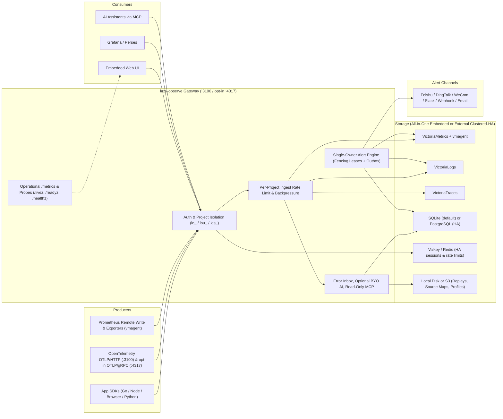

# lazy-observe

[简体中文](README.zh-CN.md)

**lazy-observe** is a self-hosted, full-stack observability platform compiled into a single pure-Go binary (`CGO_ENABLED=0`) for Linux `amd64` and `arm64`. It unifies **Metrics, Logs, Traces, Error Tracking, Web Vitals, Session Replay, Continuous Profiling, Alerting, and GenAI Usage & Cost** in one project-isolated platform—embedding VictoriaMetrics, VictoriaLogs, VictoriaTraces, vmagent, and the Web UI for zero-dependency startup, while scaling cleanly to a **Clustered-HA** architecture backed by external Victoria clusters, PostgreSQL, Valkey/Redis, and S3-compatible object storage.

> **Public preview (v0.x).** No tagged release (`v0.1.0`) has been published yet. Pre-release builds use a single mutable metadata baseline (`001_baseline.sql`, [ADR 0003](.agents/docs/adr/0003-pre-release-single-database-baseline.md)); upgrading across incompatible schema changes may require recreating the metadata database, and protocols or SDKs may change incompatibly between preview versions. See [docs/version-matrix.md](docs/version-matrix.md) and [CHANGELOG.md](CHANGELOG.md) before upgrading.

---

## Architecture



- **Minimal network surface:** Only `:3100` accepts outside connections by default (plus `:4317` when `otlp_grpc.enabled: true`). In All-in-One mode, the embedded Victoria binaries extract to `<data_dir>/bin`, listen only on localhost, and are supervised with isolated exponential-backoff restarts.
- **Hard project isolation:** The gateway enforces project boundaries on every read and write—rewriting `project_id` labels and query filters for VictoriaMetrics and overriding upstream `AccountID`/`ProjectID` headers for VictoriaLogs and VictoriaTraces.
- **Three deployment topologies (`topology`):**
  - **All-in-One** (default): Single binary, SQLite (pure Go, WAL), local disk blobs, and embedded VictoriaMetrics, VictoriaLogs, VictoriaTraces, and vmagent.
  - **Standalone**: Gateway connects to external VictoriaMetrics, VictoriaLogs, and VictoriaTraces (with optional read/write endpoint splitting and supervised `vmagent`).
  - **Clustered-HA** (`topology: ha`): Multiple stateless gateway replicas sharing PostgreSQL (metadata, alert fencing leases, durable notification Outbox, vmagent leader election), Valkey/Redis (shared sessions & login rate limits), S3-compatible object storage (e.g., SeaweedFS), a shared platform encryption key, and external Victoria clusters. Validated by `lazy-observe doctor --ha` and included in the [Helm chart](deploy/helm/lazy-observe/values-standalone-ha-cluster.yaml).

---

## Core Capabilities

- **Metrics, Logs, and Traces:** Ingest via OTLP/HTTP (`POST /v1/metrics`, `/v1/logs`, `/v1/traces` on `:3100`), optional native **OTLP/gRPC** (`otlp_grpc.enabled: true`, default `:4317`, covering Traces, Metrics, and Logs with gzip and optional TLS), Prometheus remote-write 1.0 (`POST /api/v1/write`), and supervised `vmagent` exporter scraping. Query metrics with **PromQL / MetricsQL** using a **visual PromQL query builder** synced bidirectionally with the CodeMirror editor, and explore logs with **VictoriaLogs LogsQL** (structured filters, field stats, and live tailing).
- **Error Tracking & Source Maps:** Durable metadata Error Inbox (`503` + `Retry-After` backpressure, never evicting accepted work), stack-trace fingerprinting, Issue lifecycle and regression detection, and browser source-map symbolication authenticated with dedicated CI-only **source map upload tokens (`los_...`)**.
- **Browser RUM & Privacy-First Session Replay:** Web Vitals (LCP, CLS, INP, TTFB, FCP) with privacy-safe, low-cardinality **geography and device dimensions** (`country`, `device_type`, `browser_family`, `os_family`—raw IP addresses and raw User-Agent strings are never written as metric labels), W3C `traceparent` propagation on `fetch`/`XHR`, and DOM Session Replay with input masking by default, `[data-lo-block]` redaction, and error/HTTP/Web-Vital timeline markers.
- **Continuous Profiling:** pprof flame graphs for **Go** (CPU, heap, goroutine), **Node.js** (V8 CPU and sampled-heap), and **Python** (experimental in-process CPU sampling on Linux free-threaded CPython >= 3.15t with the GIL disabled; see [docs/sdk/python.md](docs/sdk/python.md)).
- **Single-Owner Alert Engine & Built-In IM Channels:** Built-in PromQL/MetricsQL, LogsQL, and platform-event (new Issue / regression) evaluation using Rendezvous hashing, PostgreSQL fencing leases ([ADR 0001](.agents/docs/adr/0001-nightingale-style-alert-engine.md), [ADR 0011](.agents/docs/adr/0011-sqlite-alert-lease-millisecond-clock.md)), and a transactional notification Outbox—no `vmalert` or Alertmanager required. Supports grouping, deduplication, storm merging, silences, **inhibition rules management UI**, per-channel rate limiting, and built-in **Feishu (Lark)**, **DingTalk**, **WeCom**, **Slack**, **Webhook** (`Idempotency-Key`), and **SMTP / Email** channels.
- **GenAI Observability, Optional BYO AI, and Read-Only MCP:** Always-on LLM usage and cost reporting built from `gen_ai.*` spans in VictoriaTraces and built-in pricing tables (no external LLM key required). Administrators may optionally configure a BYO LLM (**Settings > AI**: OpenAI, Anthropic, DeepSeek, or Ollama; API key sealed with the 256-bit platform key and never returned to the browser) for natural-language MetricsQL/LogsQL assistance and asynchronous cross-signal Issue analysis. AI clients can query project telemetry through the read-only **MCP** endpoint (`/mcp` and `lazy-observe mcp` stdio proxy) with a `lou_...` user API token.
- **Production Guardrails & Self-Observability:** Three-tier credential separation (`lo_` ingest-only, `lou_` user read/API + `X-LO-Project`, `los_` CI source-map upload-only), opt-in unified per-project **ingest rate limiting** (`ingest_rate_limit`, HTTP `429` + `Retry-After` and gRPC `ResourceExhausted` + `RetryInfo`), opt-in Prometheus **`GET /metrics`** operational exposition (`metrics_endpoint`, fail-closed auth), and built-in self-monitoring.

---

## 5-Minute Quickstart

Because no versioned release tag (`v0.1.0`) has been published yet, start from a local source build or build the local Docker image and run it with Docker Compose. Once `v0.1.0` is released, prebuilt static archives on GitHub Releases, `scripts/install.sh`, and signed multi-arch images on `ghcr.io/eimsound/lazy-observe` will work directly without building locally.

### 1. Start lazy-observe

**Option A — Single binary from source (Linux `amd64` / `arm64`)**

Prerequisites: `mise` `>= 2026.10.13`, `curl`, `tar`, and `sha256sum` (or `shasum`). `mise` installs the pinned Go, Node.js, and pnpm versions automatically.

```sh
git clone https://github.com/eimsound/lazy-observe.git
cd lazy-observe
mise install
mise run dist
./bin/lazy-observe server
```

`mise run dist` builds the Web UI, downloads and SHA-256-verifies the four Victoria storage binaries, and embeds both into `bin/lazy-observe`.

**Option B — Local Docker image + Docker Compose**

```sh
git clone https://github.com/eimsound/lazy-observe.git
cd lazy-observe
docker build -t lazy-observe:local .
cd deploy/compose
cp .env.example .env
LO_IMAGE=lazy-observe:local docker compose up -d
```

See [deploy/compose/README.md](deploy/compose/README.md) for the `--profile standalone` stack (PostgreSQL + Valkey + SeaweedFS + external Victoria services) and [deploy/systemd/README.md](deploy/systemd/README.md) for systemd deployment.

### 2. Read `initial-admin-password`, sign in, and change password

On the first start against an empty `data_dir` (default `./data`), the server:
- Writes a randomly generated `admin` password to `<data_dir>/initial-admin-password` (mode `0600`) and logs only the file path (never the password).
- Logs a one-time `lo_...` ingest API token for the `default` project.

Read the generated password:

```sh
# Option A (local binary):
cat ./data/initial-admin-password

# Option B (Docker Compose; the distroless image has no shell):
docker compose logs lazy-observe
docker run --rm --user 65532:65532 \
  -v compose_lazy-observe-data:/data:ro \
  debian:trixie-slim cat /data/initial-admin-password
```

Open <http://localhost:3100> and sign in as `admin`. The first sign-in requires replacing the generated password before any other route works; once replaced, the gateway automatically deletes `initial-admin-password`. To supply an operator-managed password without forced rotation, configure `security.admin_password_file` (`LO_SECURITY_ADMIN_PASSWORD_FILE`; see [docs/deployment.md](docs/deployment.md#first-admin-password)).

### 3. Get a project ingest token (`lo_...`)

Use the `default` project's `lo_...` token printed on first startup, or create a new project and ingest token under **Settings > Projects**.

- `lo_...` tokens are **ingest-only** (any read route returns `403 ingest_only_token`).
- For Grafana, Perses, MCP, or Query API reads, create a **Personal API token (`lou_...`)** under **Settings > Personal API tokens** and send it with `X-LO-Project: <slug>` ([docs/deployment.md](docs/deployment.md#query-api-mcp-and-grafana)).

### 4. Send your first telemetry and view it in the Web UI

**Quick check — send an OTLP/HTTP log with `curl`:**

```sh
NOW_NS=$(date +%s%N)
curl -fsS -X POST http://127.0.0.1:3100/v1/logs \
  -H "Authorization: Bearer lo_<YOUR_PROJECT_TOKEN>" \
  -H "Content-Type: application/json" \
  -d "{\"resourceLogs\":[{\"resource\":{\"attributes\":[{\"key\":\"service.name\",\"value\":{\"stringValue\":\"quickstart-demo\"}}]},\"scopeLogs\":[{\"logRecords\":[{\"timeUnixNano\":\"${NOW_NS}\",\"severityText\":\"INFO\",\"body\":{\"stringValue\":\"hello from lazy-observe quickstart\"}}]}]}]}"
```

Any OpenTelemetry SDK can also export directly to `http://127.0.0.1:3100` over OTLP/HTTP (or `127.0.0.1:4317` over OTLP/gRPC when `LO_OTLP_GRPC_ENABLED=true`) with `Authorization: Bearer lo_<YOUR_PROJECT_TOKEN>`.

**Full-signal walkthrough — run the bundled Go Fiber v3 example:**

```sh
cd sdk/go/examples/fiber
LO_DSN='http://127.0.0.1:3100/p/default@lo_<YOUR_PROJECT_TOKEN>' \
  mise exec -- go run .
```

In a second terminal:

```sh
cd sdk/go/examples/fiber
curl http://127.0.0.1:3320/trace/order-42
curl http://127.0.0.1:3320/panic
mise exec -- go run . load --url http://127.0.0.1:3320 --duration 30s --concurrency 8
```

Then open <http://localhost:3100> to inspect live data across every signal:
- **Logs:** search `quickstart-demo` or trace-correlated logs with LogsQL.
- **Metrics:** explore `http_server_request_duration_seconds` with the visual PromQL query builder or CodeMirror editor.
- **Traces:** open the `/trace/order-42` waterfall with its SQL child span.
- **Issues:** inspect the `/panic` exception grouped into an Issue with correlated logs and trace context.
- **Performance:** view throughput, P50/P95/P99 latency, error rate, and Web Vitals breakdowns.

See [`sdk/go/examples/fiber/README.md`](sdk/go/examples/fiber/README.md) for all routes in the example app.

---

## Client SDKs

All four SDKs live in this monorepo under [`sdk/`](sdk/) and use **explicit instrumentation**—importing a server SDK never monkey-patches modules or registers global OpenTelemetry providers. Packages are not yet published to npm, PyPI, or Go module tags; each guide explains how to consume the local checkout.

| Language | Package | Integrations | Guide |
| --- | --- | --- | --- |
| Go | `github.com/eimsound/lazy-observe/sdk/go` | Fiber v3, `slog`, `database/sql`, runtime metrics, CPU/heap/goroutine profiling | [docs/sdk/go.md](docs/sdk/go.md) |
| Node.js | `@lazy-observe/node` | Express, Pino, Winston, runtime metrics, errors, V8 CPU/heap profiling | [docs/sdk/node.md](docs/sdk/node.md) |
| Browser | `@lazy-observe/browser`, `@lazy-observe/react` | Errors, Web Vitals (geo/device dimensions), `fetch`/XHR tracing, Session Replay, React ErrorBoundary & route tracking | [docs/sdk/browser.md](docs/sdk/browser.md) |
| Browser builds | `@lazy-observe/bundler-plugin` | Vite plugin & `lazy-observe-sourcemaps` CLI for source-map upload (`los_...` tokens) | [docs/sdk/browser.md#source-maps](docs/sdk/browser.md#source-maps) |
| Python | `lazyobserve` | Django (WSGI/ASGI & streaming), DRF, `logging`, DB queries, LLM calls, experimental CPU profiling (3.15t) | [docs/sdk/python.md](docs/sdk/python.md) |

Server and SDK compatibility rules are tracked in [docs/version-matrix.md](docs/version-matrix.md).

---

## Documentation Index

| Document | Audience & Topics |
| --- | --- |
| [docs/deployment.md](docs/deployment.md) | All-in-One, Standalone, PostgreSQL, Redis, S3, Helm HA, configuration reference (`config.example.yaml`), Query API / MCP |
| [docs/operations.md](docs/operations.md) | Day-two runbook: hot/cold backups, restore, `doctor --ha` preflight, upgrades, rollbacks, key rotation, password reset |
| [docs/grafana-perses.md](docs/grafana-perses.md) | Connecting Grafana and Perses (Prometheus direct connect, Nginx/Caddy rewrite proxy for Logs & Traces, provisioning manifests) |
| [docs/comparison.md](docs/comparison.md) | Architectural comparison with SigNoz, OpenObserve, Sentry, and Traceway—including when **not** to choose lazy-observe |
| [docs/version-matrix.md](docs/version-matrix.md) | Server ↔ SDK protocol surface, token contracts, ingest rate limiting, `/metrics`, and compatibility matrix |
| [deploy/compose/README.md](deploy/compose/README.md) | Hardened Docker Compose reference (All-in-One and `--profile standalone` external stack) |
| [deploy/systemd/README.md](deploy/systemd/README.md) | Hardened Linux systemd unit, graceful draining, and offline CLI maintenance |
| [docs/sdk/go.md](docs/sdk/go.md) · [node.md](docs/sdk/node.md) · [browser.md](docs/sdk/browser.md) · [python.md](docs/sdk/python.md) | Per-language SDK installation, configuration, and integration guides |
| [CONTRIBUTING.md](CONTRIBUTING.md) | Contributor setup, `mise` tasks, test layers (`e2e`, `e2e-ha`, `web-e2e-real`, `sdk-journeys`), and PR rules |
| [CHANGELOG.md](CHANGELOG.md) | Full record of unreleased changes and pre-release history |
| [.agents/docs/architecture.md](.agents/docs/architecture.md) · [.agents/docs/adr/](.agents/docs/adr/) | Deep architecture notes and Architecture Decision Records (ADRs) |

---

## Key Design Trade-offs & Preview Status

- **Victoria-only signal storage ([ADR 0013](.agents/docs/adr/0013-signal-storage-is-victoria-only.md)):** Metrics, logs, and traces storage is fixed to VictoriaMetrics, VictoriaLogs, and VictoriaTraces. Loki/LogQL and Tempo/TraceQL backends are intentionally out of scope.
- **No built-in drag-and-drop dashboards ([ADR 0017](.agents/docs/adr/0017-no-built-in-dashboards.md)):** lazy-observe keeps focused built-in diagnostic screens (Overview, Performance, Hosts, LLM, Metrics/Logs/Traces explorers, Profiling) and delegates custom dashboards to Grafana or Perses ([docs/grafana-perses.md](docs/grafana-perses.md)).
- **Public preview (v0.x, [ADR 0003](.agents/docs/adr/0003-pre-release-single-database-baseline.md)):** Until the first supported release introduces append-only migrations, schema baseline changes require recreating the metadata database. Review [docs/comparison.md](docs/comparison.md) for explicit product boundaries before adopting in production.
- **Security disclosures:** Please report suspected vulnerabilities privately via GitHub Security Advisories on `eimsound/lazy-observe` rather than opening a public issue.

---

## Development

```sh
mise install
mise run dev
```

`mise run dev` starts the Vite dev server on `:5173`, the Go gateway on `:3100` (API-only in dev, auto-rebuilt by Air), and the supervised Victoria storage binaries. Open <http://localhost:5173>. Self-monitoring is off in development; enable it with `LO_DEV_SELF_MONITORING=true mise run dev`.

See [CONTRIBUTING.md](CONTRIBUTING.md) for all `mise` tasks, license gates, and test suites.

---

## License

lazy-observe is licensed under the [MIT License](LICENSE). Production and runtime dependency graphs enforce zero AGPL/GPL dependencies via `scripts/check-go-licenses.sh` and `scripts/check-js-licenses.sh`. Release archives and container images also include the Apache-2.0 licenses of the bundled VictoriaMetrics components ([`third_party/victoria/`](third_party/victoria/)) and third-party dependency notices ([`third_party/go/THIRD_PARTY_NOTICES.txt`](third_party/go/THIRD_PARTY_NOTICES.txt), [`web/THIRD_PARTY_LICENSES.md`](web/THIRD_PARTY_LICENSES.md)).
