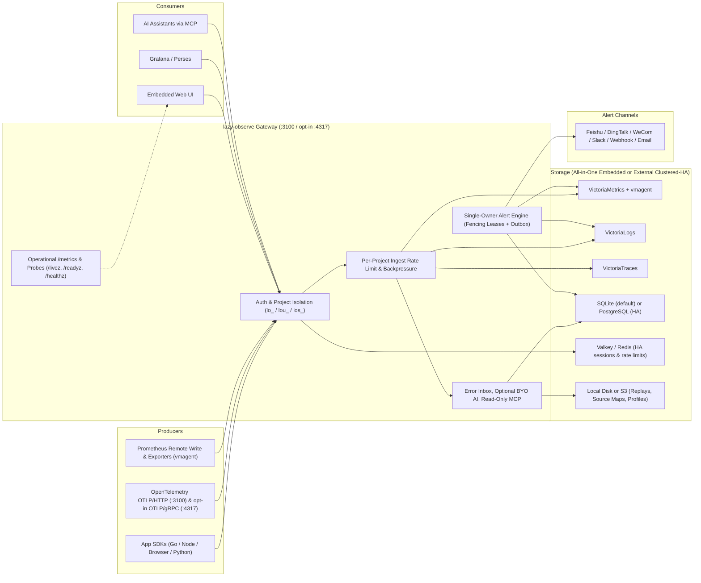

# lazy-observe

[简体中文](README.zh-CN.md) | [Documentation site](https://eimsound.github.io/lazy-observe/)

**lazy-observe** is a self-hosted, full-stack observability platform compiled into a single pure-Go binary (`CGO_ENABLED=0`) for Linux `amd64` and `arm64`. It brings metrics, logs, traces, error tracking, Web Vitals, session replay, continuous profiling, alerting, and GenAI usage and cost reporting into one project-isolated platform. By default, the binary embeds VictoriaMetrics, VictoriaLogs, VictoriaTraces, `vmagent`, and the web UI for zero-dependency startup. When a single host is no longer enough, the same binary switches to a clustered high-availability topology backed by external Victoria clusters, PostgreSQL, Valkey or Redis, and S3-compatible object storage.

> **Public preview (v0.x).** No tagged release (`v0.1.0`) has been published yet. Pre-release builds use a single mutable metadata baseline (`001_baseline.sql`, [ADR 0003](.agents/docs/adr/0003-pre-release-single-database-baseline.md)). Upgrading across incompatible schema changes may require recreating the metadata database, and protocols or SDKs may change incompatibly between preview versions. Review [docs/version-matrix.md](docs/version-matrix.md) and [CHANGELOG.md](CHANGELOG.md) before upgrading.

## Architecture



- **Minimal exposed ports.** Only `:3100` accepts outside connections by default, with `:4317` enabled only when `otlp_grpc.enabled` is `true`. In all-in-one mode, the gateway extracts the embedded Victoria binaries to `<data_dir>/bin`, binds them only to localhost, and supervises each process with isolated exponential backoff restarts.
- **Hard project isolation.** The gateway enforces project boundaries on every read and write. It rewrites `project_id` labels and query filters for VictoriaMetrics, and it overrides upstream `AccountID` and `ProjectID` headers for VictoriaLogs and VictoriaTraces.
- **Three deployment topologies (`topology`).**
  - **All-in-one.** Default single binary with pure-Go SQLite in WAL mode, local disk blobs, and embedded VictoriaMetrics, VictoriaLogs, VictoriaTraces, and `vmagent`.
  - **Standalone.** Gateway connected to external VictoriaMetrics, VictoriaLogs, and VictoriaTraces, with optional read and write endpoint splitting and a supervised `vmagent`.
  - **Clustered-HA (`topology: ha`).** Multiple stateless gateway replicas sharing PostgreSQL for metadata, alert fencing leases, the durable notification outbox, and `vmagent` leader election, plus Valkey or Redis for shared sessions and login rate limits, S3-compatible object storage such as SeaweedFS, a shared platform encryption key, and external Victoria clusters. Validate readiness with `lazy-observe doctor --ha` and use the [Helm chart](deploy/helm/lazy-observe/values-standalone-ha-cluster.yaml).

## Core capabilities

- **Metrics, logs, and traces.** Ingest data over OTLP/HTTP (`POST /v1/metrics`, `/v1/logs`, and `/v1/traces` on `:3100`), optional native OTLP/gRPC enabled via `otlp_grpc.enabled: true` on `:4317` for traces, metrics, and logs with gzip and optional TLS, Prometheus remote-write 1.0 (`POST /api/v1/write`), and supervised `vmagent` exporter scraping. `/v1/metrics` and `/v1/logs` require `http/protobuf` (`application/x-protobuf`), while `/v1/traces` accepts both Protobuf and JSON. Query metrics with PromQL and MetricsQL using a visual query builder synced bidirectionally with the CodeMirror editor, and inspect logs with VictoriaLogs LogsQL, structured filters, field stats, and live tailing.
- **Error tracking and source maps.** Store incoming errors in a durable metadata Error Inbox that returns `503` with `Retry-After` under backpressure and never drops accepted work. Group events into issues by stack-trace fingerprint, detect regressions, and symbolicate browser stacks with dedicated CI source-map upload tokens (`los_...`).
- **Browser RUM and privacy-first session replay.** Collect LCP, CLS, INP, TTFB, and FCP Web Vitals with low-cardinality geography and device labels (`country`, `device_type`, `browser_family`, `os_family`). The gateway never writes raw IP addresses or raw User-Agent strings as metric labels. Propagate W3C `traceparent` headers on `fetch` and `XHR` calls, and record DOM session replays with input masking enabled by default, `[data-lo-block]` redaction, and timeline markers for errors, HTTP requests, and Web Vitals.
- **Continuous profiling.** View pprof flame graphs for Go (CPU, heap, and goroutine), Node.js (V8 CPU and sampled-heap), and Python (experimental in-process CPU sampling on Linux free-threaded CPython 3.15t or newer without the GIL; see [docs/sdk/python.md](docs/sdk/python.md)).
- **Single-owner alert engine and built-in IM channels.** Evaluate PromQL/MetricsQL rules, LogsQL rules, and platform events such as new issues and regressions inside the gateway, with no `vmalert` or Alertmanager required. HA mode uses Rendezvous hashing, PostgreSQL fencing leases ([ADR 0001](.agents/docs/adr/0001-nightingale-style-alert-engine.md), [ADR 0011](.agents/docs/adr/0011-sqlite-alert-lease-millisecond-clock.md)), and a transactional notification outbox. Supported controls include grouping, deduplication, storm merging, silences, an inhibition rules UI, and per-channel rate limits, with built-in Feishu (Lark), DingTalk, WeCom, Slack, Webhook (`Idempotency-Key`), and SMTP/Email channels.
- **GenAI usage and cost, optional BYO AI, and read-only MCP.** Report LLM token usage and estimated cost from `gen_ai.*` spans in VictoriaTraces using built-in pricing tables, with no external LLM key required. Administrators may optionally configure a BYO LLM under **Settings**, **AI** using OpenAI, Anthropic, DeepSeek, or Ollama. API keys stay encrypted with the 256-bit platform key and never return to the browser, enabling natural-language MetricsQL and LogsQL assistance and asynchronous cross-signal issue analysis. External AI clients can query project telemetry through the read-only MCP endpoint (`/mcp` and `lazy-observe mcp` stdio proxy) with a `lou_...` user API token.
- **Production guardrails and self-observability.** Separate credentials into three tiers: `lo_` for ingest only, `lou_` with `X-LO-Project` for user read and API access, and `los_` for CI source-map uploads only. Enable opt-in per-project ingest rate limiting via `ingest_rate_limit`, which returns HTTP `429` with `Retry-After` or gRPC `ResourceExhausted` with `RetryInfo`, opt-in Prometheus `GET /metrics` operational exposition via `metrics_endpoint` with fail-closed auth, and built-in self-monitoring.

## Five-minute quickstart

Because no versioned release tag (`v0.1.0`) has been published yet, start from a local source build or build the local Docker image and run it with Docker Compose. Once `v0.1.0` is released, prebuilt static archives on GitHub Releases, `scripts/install.sh`, and signed multi-arch images on `ghcr.io/eimsound/lazy-observe` will work directly without building locally.

### 1. Start lazy-observe

**Build a single binary from source (Linux `amd64` and `arm64`).** You need `mise` `>= 2026.10.13`, `curl`, `tar`, and `sha256sum` or `shasum`. `mise` installs the pinned Go, Node.js, and pnpm versions automatically.

```sh
git clone https://github.com/eimsound/lazy-observe.git
cd lazy-observe
mise install
mise run dist
./bin/lazy-observe server
```

`mise run dist` builds the web UI, downloads and SHA-256-verifies the four Victoria storage binaries, and embeds both into `bin/lazy-observe`.

**Build a local Docker image and start with Docker Compose.**

```sh
git clone https://github.com/eimsound/lazy-observe.git
cd lazy-observe
docker build -t lazy-observe:local .
cd deploy/compose
sed 's|^LO_IMAGE=.*|LO_IMAGE=lazy-observe:local|' .env.example > .env
docker compose up -d
```

See [deploy/compose/README.md](deploy/compose/README.md) for the `--profile standalone` stack with PostgreSQL, Valkey, SeaweedFS, and external Victoria services, and see [deploy/systemd/README.md](deploy/systemd/README.md) for systemd deployment.

### 2. Read the initial admin password and sign in

On the first start against an empty `data_dir`, which defaults to `./data`, the server performs two bootstrap steps:

- It writes a randomly generated `admin` password to `<data_dir>/initial-admin-password` with mode `0600` and logs only the file path, never the password.
- It logs a one-time `lo_...` ingest API token for the `default` project.

Read the generated password:

```sh
# Local single binary:
cat ./data/initial-admin-password

# Docker Compose (the distroless image has no shell):
docker compose logs lazy-observe
docker run --rm --user 65532:65532 \
  -v compose_lazy-observe-data:/data:ro \
  debian:trixie-slim cat /data/initial-admin-password
```

Open <http://localhost:3100> and sign in as `admin`. The first sign-in requires replacing the generated password before any other route works. Once replaced, the gateway deletes `initial-admin-password` automatically. To supply an operator-managed password without forced rotation, configure `security.admin_password_file` (`LO_SECURITY_ADMIN_PASSWORD_FILE`); see [docs/deployment.md](docs/deployment.md#first-admin-password).

### 3. Get a project ingest token (`lo_...`)

Use the `default` project's `lo_...` token printed on first startup, or create a new project and ingest token under **Settings**, **Projects**.

- `lo_...` tokens are ingest-only. Any read route returns `403 ingest_only_token`.
- For Grafana, Perses, MCP, or Query API reads, create a Personal API token (`lou_...`) under **Settings**, **Personal API tokens** and send it with `X-LO-Project: <slug>`; see [docs/deployment.md](docs/deployment.md#query-api-mcp-and-grafana).

### 4. Send telemetry and inspect it in the web UI

**Quick check with `curl`.** Send one JSON error event to `POST /api/events/errors`:

```sh
NOW_ISO=$(date -u +%Y-%m-%dT%H:%M:%SZ)
EVENT_ID="quickstart-$(date -u +%Y%m%d%H%M%S)"
curl -fsS -X POST http://127.0.0.1:3100/api/events/errors \
  -H "Authorization: Bearer lo_<YOUR_PROJECT_TOKEN>" \
  -H "Content-Type: application/json" \
  -d "{\"events\":[{\"event_id\":\"${EVENT_ID}\",\"timestamp\":\"${NOW_ISO}\",\"platform\":\"go\",\"level\":\"error\",\"message\":\"hello from lazy-observe quickstart\",\"exception\":{\"type\":\"QuickstartError\",\"value\":\"hello from lazy-observe quickstart\"}}]}"
```

The endpoint returns `{"accepted":1}`, and the event appears on the **Issues** page. Any standard OpenTelemetry SDK can also export directly to `http://127.0.0.1:3100` over OTLP/HTTP using `http/protobuf` (`application/x-protobuf`). `/v1/metrics` and `/v1/logs` accept Protobuf only, while `/v1/traces` accepts both Protobuf and JSON. When `LO_OTLP_GRPC_ENABLED=true`, OpenTelemetry SDKs can also export to `127.0.0.1:4317` over OTLP/gRPC with `Authorization: Bearer lo_<YOUR_PROJECT_TOKEN>`.

**Full-signal walkthrough with the Go Fiber v3 example.**

```sh
cd sdk/go/examples/fiber
LO_DSN='http://127.0.0.1:3100/p/default@lo_<YOUR_PROJECT_TOKEN>' \
  mise exec -- go run .
```

In a second terminal:

```sh
cd sdk/go/examples/fiber
curl http://127.0.0.1:3320/trace/order-42
curl http://127.0.0.1:3320/panic
mise exec -- go run . load --url http://127.0.0.1:3320 --duration 30s --concurrency 8
```

Open <http://localhost:3100> to inspect live data across every signal:

- **Logs.** Search `lazy-observe-fiber-example` or `"order trace complete"`, along with trace-correlated logs, using LogsQL.
- **Metrics.** Query `http.server.request.duration_count` or `http.server.request.duration_bucket` in the visual PromQL query builder, which supports dotted metric names natively, or in the CodeMirror editor.
- **Traces.** Open the `/trace/order-42` waterfall with its SQL child span.
- **Issues.** Inspect the `QuickstartError` smoke event and the `/panic` exception grouped into issues with correlated logs and trace context.
- **Performance.** Switch to the **Backend endpoints** tab to view route throughput, P50/P95/P99 latency, and error rate from the Fiber example. The default **Web Vitals** tab shows geography and device breakdowns once you connect the Browser SDK or post to `POST /api/events/vitals`.

See [`sdk/go/examples/fiber/README.md`](sdk/go/examples/fiber/README.md) for all routes in the example app.

## Client SDKs

All four SDKs live in this monorepo under [`sdk/`](sdk/) and use explicit instrumentation. Importing a server SDK never monkey-patches modules or registers global OpenTelemetry providers. Packages are not yet published to npm, PyPI, or Go module tags; each guide explains how to consume the local checkout.

| Language | Package | Integrations | Guide |
| --- | --- | --- | --- |
| Go | `github.com/eimsound/lazy-observe/sdk/go` | Fiber v3, `slog`, `database/sql`, runtime metrics, CPU/heap/goroutine profiling | [docs/sdk/go.md](docs/sdk/go.md) |
| Node.js | `@lazy-observe/node` | Express, Pino, Winston, runtime metrics, errors, V8 CPU/heap profiling | [docs/sdk/node.md](docs/sdk/node.md) |
| Browser | `@lazy-observe/browser`, `@lazy-observe/react` | Errors, Web Vitals with geo and device dimensions, `fetch` and XHR tracing, session replay, React ErrorBoundary and route tracking | [docs/sdk/browser.md](docs/sdk/browser.md) |
| Browser builds | `@lazy-observe/bundler-plugin` | Vite plugin and `lazy-observe-sourcemaps` CLI for source-map upload with `los_...` tokens | [docs/sdk/browser.md#source-maps](docs/sdk/browser.md#source-maps) |
| Python | `lazyobserve` | Django WSGI/ASGI and streaming, DRF, `logging`, DB queries, LLM calls, experimental CPU profiling on 3.15t | [docs/sdk/python.md](docs/sdk/python.md) |

Server and SDK compatibility rules live in [docs/version-matrix.md](docs/version-matrix.md).

## Documentation

Read the published bilingual documentation site at <https://eimsound.github.io/lazy-observe/> for English or <https://eimsound.github.io/lazy-observe/zh/> for Simplified Chinese. Preview the site locally with `mise run docs-serve`, or run `LO_DOCS_LANG=zh mise run docs-serve` for Simplified Chinese.

| Document | Audience and topics |
| --- | --- |
| [docs/index.md](docs/index.md) | Documentation home, architecture overview, and capability summary |
| [docs/quickstart.md](docs/quickstart.md) | Five-minute quickstart from source or Docker Compose through live UI inspection |
| [docs/deployment.md](docs/deployment.md) | All-in-one, Standalone, PostgreSQL, Redis, S3, Helm HA, configuration reference (`config.example.yaml`), Query API, and MCP |
| [docs/operations.md](docs/operations.md) | Day-two runbook covering hot and cold backups, restore, `doctor --ha` preflight, upgrades, rollbacks, key rotation, and password reset |
| [docs/grafana-perses.md](docs/grafana-perses.md) | Connecting Grafana and Perses directly for Prometheus metrics, plus Nginx and Caddy rewrite proxies for logs and traces |
| [docs/comparison.md](docs/comparison.md) | Architectural comparison with SigNoz, OpenObserve, Sentry, and Traceway, including when not to choose lazy-observe |
| [docs/version-matrix.md](docs/version-matrix.md) | Protocol contract between server and SDKs, token boundaries, ingest rate limiting, `/metrics`, and compatibility matrix |
| [deploy/compose/README.md](deploy/compose/README.md) | Hardened Docker Compose reference for all-in-one and `--profile standalone` external stacks |
| [deploy/systemd/README.md](deploy/systemd/README.md) | Hardened Linux systemd unit, graceful draining, and offline CLI maintenance |
| [docs/sdk/go.md](docs/sdk/go.md), [node.md](docs/sdk/node.md), [browser.md](docs/sdk/browser.md), [python.md](docs/sdk/python.md) | Per-language SDK installation, configuration, and integration guides |
| [SECURITY.md](SECURITY.md) | Security policy, supported preview scope, and private vulnerability reporting |
| [CONTRIBUTING.md](CONTRIBUTING.md) | Contributor setup, `mise` tasks, test layers (`e2e`, `e2e-ha`, `web-e2e-real`, `sdk-journeys`), and PR rules |
| [CHANGELOG.md](CHANGELOG.md) | Record of unreleased changes and pre-release history |
| [.agents/docs/architecture.md](.agents/docs/architecture.md) and [.agents/docs/adr/](.agents/docs/adr/) | Deep architecture notes and Architecture Decision Records (ADRs) |

## Design trade-offs and preview status

- **Victoria-only signal storage ([ADR 0013](.agents/docs/adr/0013-signal-storage-is-victoria-only.md)).** Metrics, logs, and traces storage stays fixed to VictoriaMetrics, VictoriaLogs, and VictoriaTraces. Loki/LogQL and Tempo/TraceQL backends are out of scope.
- **No built-in drag-and-drop dashboards ([ADR 0017](.agents/docs/adr/0017-no-built-in-dashboards.md)).** lazy-observe provides fixed diagnostic screens (Overview, Performance, Hosts, LLM, Metrics/Logs/Traces explorers, and Profiling) and delegates custom dashboards to Grafana or Perses; see [docs/grafana-perses.md](docs/grafana-perses.md).
- **Public preview ([ADR 0003](.agents/docs/adr/0003-pre-release-single-database-baseline.md)).** Until the first tagged release introduces append-only migrations, schema baseline changes require recreating the metadata database. Review [docs/comparison.md](docs/comparison.md) for product boundaries before adopting in production.
- **Security disclosures.** Report suspected vulnerabilities privately through GitHub Security Advisories on `eimsound/lazy-observe` rather than opening a public issue; see [SECURITY.md](SECURITY.md).

## Development

```sh
mise install
mise run dev
```

`mise run dev` starts the Vite dev server on `:5173`, the Go gateway on `:3100` in API-only mode with Air auto-rebuild, and the supervised Victoria storage binaries. Open <http://localhost:5173>. Self-monitoring stays off in development; enable it with `LO_DEV_SELF_MONITORING=true mise run dev`.

To preview the Zensical documentation site locally, run `mise run docs-serve` for English or `LO_DOCS_LANG=zh mise run docs-serve` for Simplified Chinese. Run `mise run docs-build` to build both languages into `site/` and `site/zh/`.

See [CONTRIBUTING.md](CONTRIBUTING.md) for all `mise` tasks, license gates, and test suites.

## License

lazy-observe is licensed under the [MIT License](LICENSE). Production and runtime dependency graphs enforce zero AGPL or GPL dependencies through `scripts/check-go-licenses.sh` and `scripts/check-js-licenses.sh`. Release archives and container images also include the Apache-2.0 licenses of the bundled VictoriaMetrics components ([`third_party/victoria/`](third_party/victoria/)) and third-party dependency notices ([`third_party/go/THIRD_PARTY_NOTICES.txt`](third_party/go/THIRD_PARTY_NOTICES.txt) and [`web/THIRD_PARTY_LICENSES.md`](web/THIRD_PARTY_LICENSES.md)).
