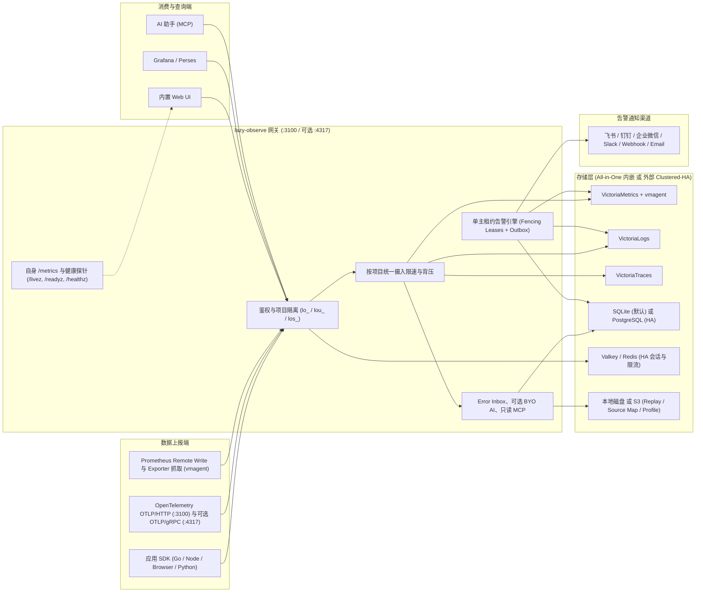

# lazy-observe

[English](README.md)

**lazy-observe** 是一款采用纯 Go 静态编译（`CGO_ENABLED=0`，支持 Linux `amd64` / `arm64`）的单二进制自托管全栈可观测性平台。它在一个项目隔离的平台中统一覆盖 **Metrics、Logs、Traces、Error Tracking、Web Vitals、Session Replay、Continuous Profiling、Alerting 与 GenAI 用量/成本**——默认内嵌 VictoriaMetrics、VictoriaLogs、VictoriaTraces、vmagent 与 Web UI 实现零外部依赖启动，同时支持平滑演进至外部 Victoria 集群 + PostgreSQL + Valkey/Redis + S3 兼容对象存储的 **Clustered-HA** 架构。

> **公开预览期（v0.x）。** 当前尚未发布带版本号的正式 Release（`v0.1.0`）。发布前阶段元数据仅维护一份可变的基线（`001_baseline.sql`，见 [ADR 0003](.agents/docs/adr/0003-pre-release-single-database-baseline.md)），跨不兼容 schema 变更升级可能需要重建元数据数据库，协议面与 SDK 也可能发生不兼容调整。升级前请先查阅 [docs/version-matrix.md](docs/version-matrix.md) 与 [CHANGELOG.md](CHANGELOG.md)。

---

## 架构总览



- **极小网络暴露面**：默认仅 `:3100` 对外提供服务（显式启用 `otlp_grpc.enabled: true` 后额外监听 `:4317`）。All-in-One 模式下，内嵌的四个 Victoria 程序解压到 `<data_dir>/bin`、仅监听本机回环地址，由内置 Supervisor 提供独立指数退避重启。
- **硬性项目隔离**：网关在所有读写路径强制执行项目租户隔离——向 VictoriaMetrics 写入与查询强制注入 `project_id` 边界，向 VictoriaLogs / VictoriaTraces 覆盖上游 `AccountID` / `ProjectID` 请求头。
- **三种部署拓扑（`topology`）**：
  - **All-in-One（默认）**：单二进制 + 纯 Go SQLite（WAL）+ 本地 Blob + 内嵌 VictoriaMetrics / VictoriaLogs / VictoriaTraces / vmagent。
  - **Standalone**：网关对接外部 VictoriaMetrics / VictoriaLogs / VictoriaTraces（支持读写端点分拆与可选托管 `vmagent`）。
  - **Clustered-HA（`topology: ha`）**：多无状态网关副本共享 PostgreSQL（元数据、告警租约 fencing、持久化 Outbox、vmagent 选主）、Valkey/Redis（共享会话与登录限流）、S3 兼容对象存储（如 SeaweedFS）、共享平台加密密钥与外部 Victoria 集群；提供只读预检 `lazy-observe doctor --ha` 与三副本 [Helm Chart 配置](deploy/helm/lazy-observe/values-standalone-ha-cluster.yaml)。

---

## 核心能力

- **指标、日志与链路**：支持 OTLP/HTTP（`:3100` 上 `POST /v1/metrics`、`/v1/logs`、`/v1/traces`，请使用 `http/protobuf` / `application/x-protobuf`——`/v1/metrics` 与 `/v1/logs` 仅支持 Protobuf，`/v1/traces` 同时支持 Protobuf 与 JSON）、可选原生 **OTLP/gRPC**（`otlp_grpc.enabled: true`，默认 `:4317`，覆盖 Traces/Metrics/Logs，支持 gzip 与原生 TLS）、Prometheus remote-write 1.0（`POST /api/v1/write`）及内置 `vmagent` 主动抓取。指标页提供与 CodeMirror 双向联动的**可视化 PromQL 查询构建器**，日志页提供 VictoriaLogs **LogsQL** 探索器（字段统计、结构化筛选与实时 Live Tail）。
- **错误追踪与 Source Map**：基于持久化元数据 Error Inbox 接收错误（满载返回 `503` + `Retry-After` 背压，绝不驱逐已接收事件），按堆栈指纹聚合 Issue、识别回归，并使用专用的 CI **Source Map 上传 Token（`los_...`）**还原浏览器报错源码。
- **浏览器 RUM 与隐私优先 Session Replay**：采集 LCP / CLS / INP / TTFB / FCP 五项 Web Vitals，支持低基数**地理与设备维度分析**（`country`、`device_type`、`browser_family`、`os_family`——绝不将原始 IP 或原始 `User-Agent` 写入指标标签）；自动向 `fetch`/`XHR` 注入 W3C `traceparent`；DOM 会话回放默认遮蔽所有输入值、支持 `[data-lo-block]` 子树屏蔽与错误/HTTP/Web Vitals 时间线标记。
- **持续性能剖析（Continuous Profiling）**：pprof 火焰图覆盖 **Go**（CPU / heap / goroutine）、**Node.js**（V8 CPU / sampled-heap）及 **Python**（experimental，仅在 Linux 无 GIL 的 free-threaded CPython >= 3.15t 上支持进程内 CPU 采样，详见 [docs/sdk/python.md](docs/sdk/python.md)）。
- **单主租约告警引擎与内置国内 IM 渠道**：内置 PromQL/MetricsQL、LogsQL 与平台事件（新 Issue / 回归）评估器，基于 Rendezvous 哈希、PostgreSQL 隔离纪元租约（[ADR 0001](.agents/docs/adr/0001-nightingale-style-alert-engine.md)、[ADR 0011](.agents/docs/adr/0011-sqlite-alert-lease-millisecond-clock.md)）与事务级持久化 Outbox，无需单独部署 `vmalert` 或 Alertmanager。支持分组、去重、风暴汇总、静默、**告警抑制规则管理页面**、按渠道限流，开箱内置**飞书（Feishu/Lark）**、**钉钉（DingTalk）**、**企业微信（WeCom）**、**Slack**、**Webhook**（带 `Idempotency-Key`）与 **SMTP / Email**。
- **GenAI 用量/成本、可选 BYO AI 助手与只读 MCP**：基于 VictoriaTraces 中的 `gen_ai.*` Span 与内置模型定价表，默认常开统计业务应用的 LLM Token 用量与估算费用（无需配置外部 LLM API Key）。管理员可在 **Settings > AI** 按需配置 BYO LLM（OpenAI / Anthropic / DeepSeek / Ollama，密钥使用 256-bit 平台密钥加密存储且永不回传浏览器），启用自然语言生成/解释查询及新 Issue 异步跨信号分析。AI 助手可通过只读 **MCP** 端点（`/mcp` 与 `lazy-observe mcp` stdio 代理）配合 `lou_...` 用户 API Token 读取项目数据。
- **生产级安全边界与自监控**：严格三权分立 Token（`lo_` 仅摄取、`lou_` 用户读/API + `X-LO-Project`、`los_` 仅 CI 上传 Source Map）、可选按项目统一**摄入限速与背压**（`ingest_rate_limit`，HTTP `429` + `Retry-After` / gRPC `ResourceExhausted` + `RetryInfo`）、可选 Prometheus 自身 **`GET /metrics`** 端点（`metrics_endpoint`，默认 fail-closed 鉴权）与内置自监控。

---

## 5 分钟快速上手

当前尚未发布 `v0.1.0` 正式 tag，你可以直接从源码一键构建单二进制，或本地构建镜像后用 Docker Compose 启动。待 `v0.1.0` 发布后，即可直接通过 GitHub Releases 静态归档、`scripts/install.sh` 或 `ghcr.io/eimsound/lazy-observe` 签名容器镜像开箱运行。

### 1. 启动服务

**方式 A — 从源码构建并运行单二进制（Linux `amd64` / `arm64`）**

前置条件：`mise` `>= 2026.10.13`、`curl`、`tar` 以及 `sha256sum`（或 `shasum`）。`mise` 会自动安装仓库锁定的 Go、Node.js 与 pnpm 版本。

```sh
git clone https://github.com/eimsound/lazy-observe.git
cd lazy-observe
mise install
mise run dist
./bin/lazy-observe server
```

`mise run dist` 会构建 Web UI、下载并校验四个 Victoria 存储二进制的 SHA-256，并将其全部嵌入 `bin/lazy-observe`。

**方式 B — 本地构建容器镜像 + Docker Compose 启动**

```sh
git clone https://github.com/eimsound/lazy-observe.git
cd lazy-observe
docker build -t lazy-observe:local .
cd deploy/compose
sed 's|^LO_IMAGE=.*|LO_IMAGE=lazy-observe:local|' .env.example > .env
docker compose up -d
```

外置存储参考栈（`--profile standalone`，含 PostgreSQL + Valkey + SeaweedFS + 外部 Victoria）见 [deploy/compose/README.md](deploy/compose/README.md)，Linux 物理机/虚拟机部署见 [deploy/systemd/README.md](deploy/systemd/README.md)。

### 2. 读取 `initial-admin-password` 登录并修改初始密码

首次面对空 `data_dir`（默认 `./data`）启动时，服务端会：
- 生成随机 `admin` 密码并写入 `<data_dir>/initial-admin-password`（权限 `0600`），日志只记录文件路径而不打印明文；
- 在日志中打印一次 `default` 项目的摄取 API Token（`lo_...`）。

读取初始密码：

```sh
# 方式 A（本地单二进制）：
cat ./data/initial-admin-password

# 方式 B（Docker Compose，distroless 镜像无 shell）：
docker compose logs lazy-observe
docker run --rm --user 65532:65532 \
  -v compose_lazy-observe-data:/data:ro \
  debian:trixie-slim cat /data/initial-admin-password
```

打开 <http://localhost:3100> 并使用 `admin` 登录。首次登录必须修改这个随机密码后才能访问其他页面，改密完成后网关会自动删除 `initial-admin-password`。如需自行指定初始密码（不强制改密），请配置 `security.admin_password_file`（`LO_SECURITY_ADMIN_PASSWORD_FILE`，见 [docs/deployment.md](docs/deployment.md#first-admin-password)）。

### 3. 获取项目摄取 Token（`lo_...`）

可以直接使用首次启动日志里打印的 `default` 项目 `lo_...` Token，或在 Web UI 的 **Settings > Projects（设置 → 项目）** 中创建新项目并生成项目 API Token。

- `lo_...` 令牌**仅用于数据摄取**（访问任意读接口均返回 `403 ingest_only_token`）。
- 如需接入 Grafana、Perses、MCP 或查询 API，请在 **Settings > Personal API tokens（设置 → 个人 API Token）** 创建 `lou_...` 用户 API Token 并附带 `X-LO-Project: <slug>` 请求头（见 [docs/deployment.md](docs/deployment.md#query-api-mcp-and-grafana)）。

### 4. 发送第一条遥测数据并在 Web UI 查看

**10 秒验证 — 用 `curl` 发送一条原生 JSON 错误事件：**

```sh
NOW_ISO=$(date -u +%Y-%m-%dT%H:%M:%SZ)
EVENT_ID="quickstart-$(date -u +%Y%m%d%H%M%S)"
curl -fsS -X POST http://127.0.0.1:3100/api/events/errors \
  -H "Authorization: Bearer lo_<YOUR_PROJECT_TOKEN>" \
  -H "Content-Type: application/json" \
  -d "{\"events\":[{\"event_id\":\"${EVENT_ID}\",\"timestamp\":\"${NOW_ISO}\",\"platform\":\"go\",\"level\":\"error\",\"message\":\"hello from lazy-observe quickstart\",\"exception\":{\"type\":\"QuickstartError\",\"value\":\"hello from lazy-observe quickstart\"}}]}"
```

接口返回 `{"accepted":1}` 后，事件会立刻出现在 **问题（Issues）** 页面。任意标准 OpenTelemetry SDK 也可以直接向 `http://127.0.0.1:3100` 上报 OTLP/HTTP——请使用 **`http/protobuf`（`application/x-protobuf`）**（`/v1/metrics` 与 `/v1/logs` 仅支持 Protobuf，`/v1/traces` 同时支持 Protobuf 与 JSON），或在开启 `LO_OTLP_GRPC_ENABLED=true` 后向 `127.0.0.1:4317` 上报 OTLP/gRPC，请求头携带 `Authorization: Bearer lo_<YOUR_PROJECT_TOKEN>` 即可。

**全信号体验 — 运行仓库内置的 Go Fiber v3 示例应用：**

```sh
cd sdk/go/examples/fiber
LO_DSN='http://127.0.0.1:3100/p/default@lo_<YOUR_PROJECT_TOKEN>' \
  mise exec -- go run .
```

再开一个终端：

```sh
cd sdk/go/examples/fiber
curl http://127.0.0.1:3320/trace/order-42
curl http://127.0.0.1:3320/panic
mise exec -- go run . load --url http://127.0.0.1:3320 --duration 30s --concurrency 8
```

随后打开 <http://localhost:3100>，即可立刻在各页面看到实时数据：
- **日志（Logs）**：用 LogsQL 检索 `lazy-observe-fiber-example` 或 `"order trace complete"` 及带 `trace_id` 关联的日志；
- **指标（Metrics）**：通过可视化 PromQL 查询构建器（原生支持点分指标名）或 CodeMirror 编辑器查看 `http.server.request.duration_count`（或 `http.server.request.duration_bucket`）；
- **链路（Traces）**：查看 `/trace/order-42` 的完整瀑布图与 SQL 子 Span；
- **问题（Issues）**：查看上述 `QuickstartError` 冒烟事件以及 `/panic` 触发并自动归并的异常 Issue 及关联上下文；
- **性能（Performance）**：切换到 **后端接口（Backend endpoints）** 标签页查看 Fiber 示例产生的路由吞吐量、P50/P95/P99 延迟与错误率（默认的 **Web Vitals** 标签页会在接入浏览器 SDK 或向 `POST /api/events/vitals` 上报后展示地理与设备维度分解）。

示例应用的全部路由说明见 [`sdk/go/examples/fiber/README.md`](sdk/go/examples/fiber/README.md)。

---

## 客户端 SDK

四端 SDK 均在同仓 [`sdk/`](sdk/) 下维护，坚持**显式接入**——导入服务端 SDK 绝不做全局 Monkey-Patch 或篡改全局 OpenTelemetry Provider。目前尚未发布到 npm / PyPI 或 Go 模块 tag，各语言文档均提供了基于本地仓库的接入方式。

| 语言 | 包名 | 内置集成 | 文档 |
| --- | --- | --- | --- |
| Go | `github.com/eimsound/lazy-observe/sdk/go` | Fiber v3、`slog`、`database/sql`、运行时指标、CPU/heap/goroutine 持续剖析 | [docs/sdk/go.md](docs/sdk/go.md) |
| Node.js | `@lazy-observe/node` | Express、Pino、Winston、运行时指标、错误上报、V8 CPU/heap 剖析 | [docs/sdk/node.md](docs/sdk/node.md) |
| 浏览器 | `@lazy-observe/browser`、`@lazy-observe/react` | 错误捕获、Web Vitals（含地理/设备维度）、`fetch`/XHR 链路、Session Replay、React 错误边界与路由追踪 | [docs/sdk/browser.md](docs/sdk/browser.md) |
| 浏览器构建 | `@lazy-observe/bundler-plugin` | Vite 插件与 `lazy-observe-sourcemaps` CLI（使用 `los_...` 上传令牌） | [docs/sdk/browser.md#source-maps](docs/sdk/browser.md#source-maps) |
| Python | `lazyobserve` | Django（WSGI/ASGI 与流式响应）、DRF、`logging`、DB 查询、LLM 埋点、实验性 CPU 剖析（3.15t） | [docs/sdk/python.md](docs/sdk/python.md) |

服务端与各端 SDK 的协议及版本兼容关系见 [docs/version-matrix.md](docs/version-matrix.md)。

---

## 文档导航

| 文档 | 面向读者与主要内容 |
| --- | --- |
| [docs/deployment.md](docs/deployment.md) | 部署总览：All-in-One、Standalone、PostgreSQL、Redis、S3、Helm HA、配置说明（`config.example.yaml`）、查询 API 与 MCP |
| [docs/operations.md](docs/operations.md) | 运维手册：冷/热备份、恢复、`doctor --ha` 预检、升级与回滚、平台密钥轮换与密码应急重置 |
| [docs/grafana-perses.md](docs/grafana-perses.md) | Grafana 与 Perses 对接：指标直连、日志/链路路径重写代理样例与 Provisioning 清单 |
| [docs/comparison.md](docs/comparison.md) | 开源平台横向对比：与 SigNoz / OpenObserve / Sentry / Traceway 的架构取舍及**何时不要选 lazy-observe** |
| [docs/version-matrix.md](docs/version-matrix.md) | 服务端 ↔ SDK 协议面、三类 Token 契约、摄入限速、`/metrics` 与版本兼容矩阵 |
| [deploy/compose/README.md](deploy/compose/README.md) | 加固的 Docker Compose 参考部署（All-in-One 与 `--profile standalone` 外置存储栈） |
| [deploy/systemd/README.md](deploy/systemd/README.md) | 加固的 Linux systemd 服务单元、两阶段优雅摘流与离线 CLI 维护 |
| [docs/sdk/go.md](docs/sdk/go.md) · [node.md](docs/sdk/node.md) · [browser.md](docs/sdk/browser.md) · [python.md](docs/sdk/python.md) | 四端客户端 SDK 安装、配置与框架集成指南 |
| [CONTRIBUTING.md](CONTRIBUTING.md) | 贡献者指南：`mise` 任务、测试分层（`e2e`、`e2e-ha`、`web-e2e-real`、`sdk-journeys`）与 PR 规则 |
| [CHANGELOG.md](CHANGELOG.md) | 未发布变更清单与历史演进记录 |
| [.agents/docs/architecture.md](.agents/docs/architecture.md) · [.agents/docs/adr/](.agents/docs/adr/) | 深入架构说明与架构决策记录（ADR） |

---

## 关键设计取舍与预览期说明

- **Victoria 专精存储（[ADR 0013](.agents/docs/adr/0013-signal-storage-is-victoria-only.md)）**：指标、日志与链路存储固定采用 VictoriaMetrics、VictoriaLogs 与 VictoriaTraces，按设计不支持 Loki/LogQL 或 Tempo/TraceQL 后端。
- **不内置拖拽大屏，原生对接 Grafana / Perses（[ADR 0017](.agents/docs/adr/0017-no-built-in-dashboards.md)）**：内置页面聚焦核心诊断工作流（Overview、Performance、Hosts、LLM、Metrics/Logs/Traces 查询工作区、Profiling），自定义大盘与社区看板直接交由 Grafana 或 Perses（见 [docs/grafana-perses.md](docs/grafana-perses.md)）。
- **v0.x 公开预览期（[ADR 0003](.agents/docs/adr/0003-pre-release-single-database-baseline.md)）**：在首个受支持版本引入只增不改的迁移链之前，元数据基线仍保持可变，升级时可能需要重建元数据数据库。生产选型前建议完整阅读 [docs/comparison.md](docs/comparison.md) 中的产品边界说明。
- **安全漏洞上报**：如发现疑似安全漏洞，请通过 `eimsound/lazy-observe` 仓库的 GitHub Security Advisories 私下提交，切勿在公开 Issue 中披露细节。

---

## 本地开发

```sh
mise install
mise run dev
```

`mise run dev` 会启动 `:5173` 的 Vite 开发服务器、`:3100` 的 Go 网关（开发模式仅提供 API，由 Air 热重载）以及托管的 Victoria 存储程序，开发时访问 <http://localhost:5173>。开发模式默认关闭自监控，如需开启请运行 `LO_DEV_SELF_MONITORING=true mise run dev`。

完整的 `mise` 任务、许可证门禁与测试分层见 [CONTRIBUTING.md](CONTRIBUTING.md)。

---

## 许可证

lazy-observe 采用 [MIT 许可证](LICENSE)发布。生产与运行时依赖树通过 `scripts/check-go-licenses.sh` 与 `scripts/check-js-licenses.sh` 严格禁止引入 AGPL/GPL 依赖。发布归档与容器镜像同时附带内嵌 VictoriaMetrics 系列组件的 Apache-2.0 许可证（[`third_party/victoria/`](third_party/victoria/)）以及 Go 与前端第三方依赖声明（[`third_party/go/THIRD_PARTY_NOTICES.txt`](third_party/go/THIRD_PARTY_NOTICES.txt)、[`web/THIRD_PARTY_LICENSES.md`](web/THIRD_PARTY_LICENSES.md)）。
