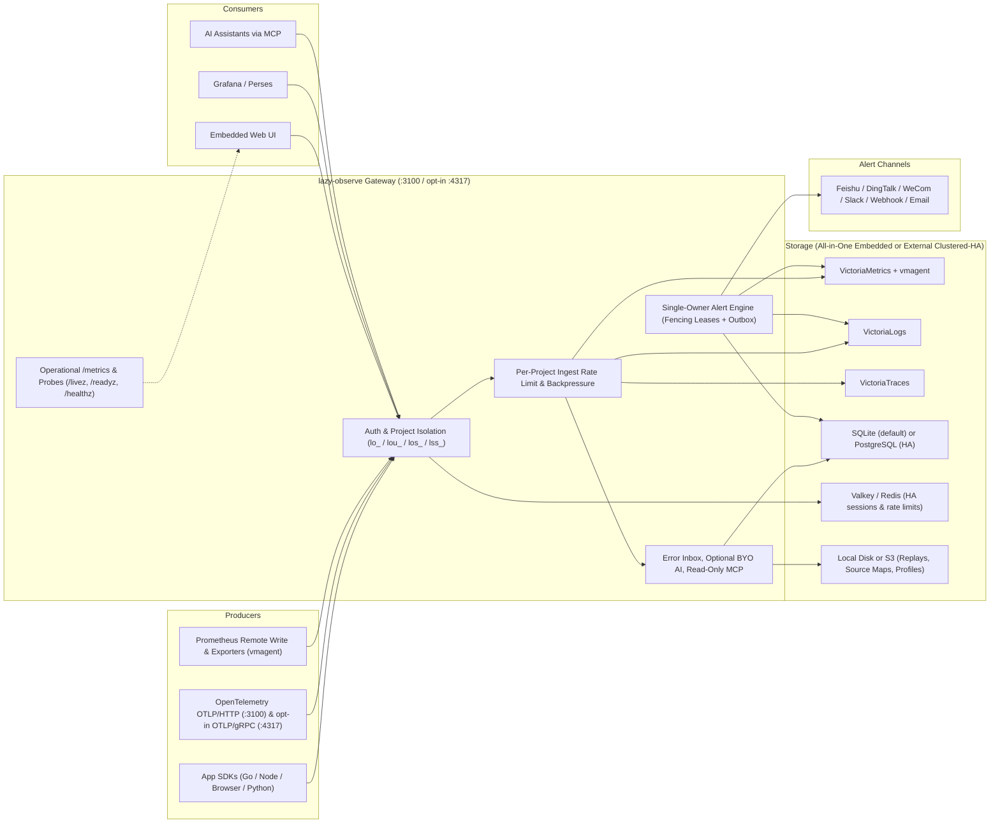

# lazy-observe

lazy-observe is a self-hosted, full-stack observability platform compiled into a single pure-Go binary (`CGO_ENABLED=0`) for Linux `amd64` and `arm64`. It brings metrics, logs, traces, error tracking, Web Vitals, session replay, continuous profiling, alerting, and GenAI usage and cost reporting into one project-isolated platform.

By default, one binary embeds VictoriaMetrics, VictoriaLogs, VictoriaTraces, `vmagent`, and the web UI so you can start with zero external dependencies. When a single host is no longer enough, the same binary switches to an external Victoria cluster backed by PostgreSQL, Valkey or Redis, and S3-compatible object storage.

> **Public preview (v0.x).** No tagged release (`v0.1.0`) has been published yet. Pre-release builds use a single mutable metadata baseline (`001_baseline.sql`, [ADR 0003](https://github.com/eimsound/lazy-observe/blob/main/.agents/docs/adr/0003-pre-release-single-database-baseline.md)). Upgrading across incompatible schema changes may require recreating the metadata database, and protocols or SDKs may change incompatibly between preview versions. Check the [version compatibility matrix](version-matrix.md) and [CHANGELOG.md](https://github.com/eimsound/lazy-observe/blob/main/CHANGELOG.md) before upgrading.

## Architecture

- **Minimal exposed ports.** Only `:3100` accepts external connections by default, with `:4317` enabled only when `otlp_grpc.enabled` is `true`. In all-in-one mode, the gateway extracts the embedded Victoria binaries to `<data_dir>/bin`, binds them only to loopback addresses, and supervises each process with isolated exponential backoff restarts.
- **Gateway-enforced project isolation.** The gateway enforces project boundaries on every read and write. It rewrites `project_id` labels and query filters for VictoriaMetrics, and it overrides upstream `AccountID` and `ProjectID` headers for VictoriaLogs and VictoriaTraces.
- **Three deployment topologies.**
  - **All-in-one.** This default mode runs a single binary with pure-Go SQLite in WAL mode, local disk blobs, and embedded VictoriaMetrics, VictoriaLogs, VictoriaTraces, and `vmagent`.
  - **Standalone.** The gateway connects to external VictoriaMetrics, VictoriaLogs, and VictoriaTraces, with optional read and write endpoint splitting and a supervised `vmagent`.
  - **Clustered-HA.** Multiple stateless gateway replicas (`topology: ha`) share PostgreSQL for metadata, alert fencing leases, the durable notification outbox, and `vmagent` leader election. Replicas also share Valkey or Redis for sessions and login rate limits, S3-compatible object storage, a shared platform encryption key, and external Victoria clusters. Validate HA readiness with `lazy-observe doctor --ha` and review the three-replica [Helm values file](https://github.com/eimsound/lazy-observe/blob/main/deploy/helm/lazy-observe/values-standalone-ha-cluster.yaml).

## Core capabilities

- **Metrics, logs, and traces.** Ingest data over OTLP/HTTP (`POST /v1/metrics`, `/v1/logs`, and `/v1/traces` on `:3100`), optional native OTLP/gRPC enabled via `otlp_grpc.enabled: true` on `:4317` with gzip and optional TLS, Prometheus remote-write 1.0 (`POST /api/v1/write`), and supervised `vmagent` exporter scraping. `/v1/metrics` and `/v1/logs` require `application/x-protobuf`, while `/v1/traces` accepts both Protobuf and JSON. Query metrics with PromQL and MetricsQL through a visual query builder synced bidirectionally with the CodeMirror editor, and search logs with VictoriaLogs LogsQL, field statistics, and live tailing.
- **Error tracking and source maps.** Store incoming error events in a durable metadata Error Inbox that returns `503` with `Retry-After` under backpressure instead of dropping accepted work. Group events into issues by stack-trace fingerprint, detect regressions, and symbolicate minified browser stacks using dedicated CI source-map upload tokens (`los_...`).
- **Browser RUM and privacy-first session replay.** Collect LCP, CLS, INP, TTFB, and FCP Web Vitals with low-cardinality geography and device labels (`country`, `device_type`, `browser_family`, `os_family`). The gateway never writes raw IP addresses or raw User-Agent strings as metric labels. Propagate W3C `traceparent` headers on `fetch` and `XHR` requests, and record DOM session replays with input masking enabled by default, `[data-lo-block]` redaction, and timeline markers for errors, HTTP calls, and Web Vitals.
- **Continuous profiling.** Inspect pprof flame graphs for Go (CPU, heap, and goroutine), Node.js (V8 CPU and sampled-heap), and Python. Python profiling uses experimental in-process CPU sampling on Linux free-threaded CPython 3.15t or newer with the GIL disabled. See [Python SDK](sdk/python.md).
- **Single-owner alert engine and built-in IM channels.** Evaluate PromQL/MetricsQL rules, LogsQL threshold rules, and platform events such as new issues and regressions inside the gateway, with no `vmalert` or Alertmanager required. HA deployments use Rendezvous hashing, PostgreSQL fencing leases ([ADR 0001](https://github.com/eimsound/lazy-observe/blob/main/.agents/docs/adr/0001-nightingale-style-alert-engine.md), [ADR 0011](https://github.com/eimsound/lazy-observe/blob/main/.agents/docs/adr/0011-sqlite-alert-lease-millisecond-clock.md)), and a transactional notification outbox. Supported controls include grouping, deduplication, storm merging, silences, an inhibition rules UI, and per-channel rate limits, with built-in Feishu (Lark), DingTalk, WeCom, Slack, Webhook (`Idempotency-Key`), and SMTP/Email channels.
- **GenAI usage and cost, optional BYO AI, and read-only MCP.** Track LLM token usage and estimated cost from `gen_ai.*` spans in VictoriaTraces with built-in model pricing tables and no external LLM API key. Administrators may configure a BYO LLM (OpenAI, Anthropic, DeepSeek, or Ollama) under **Settings**, then **AI** for natural-language MetricsQL and LogsQL help and asynchronous cross-signal issue analysis. The gateway encrypts API keys with the 256-bit platform key and never returns them to the browser. External AI clients can query project telemetry through the read-only MCP endpoint (`/mcp` and `lazy-observe mcp`) with a `lou_...` user API token.
- **Production guardrails and self-observability.** Separate credentials into four isolated types: `lo_` for ingest only, `lou_` with `X-LO-Project` for user read and API access, `los_` for CI source-map uploads only, and `lss_` for HTTP-only browser session cookies. Enable opt-in per-project ingest rate limiting via `ingest_rate_limit`, which returns HTTP `429` with `Retry-After` or gRPC `ResourceExhausted` with `RetryInfo`, opt-in Prometheus `GET /metrics` operational exposition via `metrics_endpoint` with fail-closed authentication, and built-in self-monitoring.

## Documentation map

| Guide | What it covers |
| --- | --- |
| [Five-minute quickstart](quickstart.md) | Start locally from source or Docker Compose, sign in, create tokens, and verify all signals with `curl` and the Go Fiber v3 example |
| [Deployment](deployment.md) | All-in-one, Standalone, PostgreSQL, Redis, S3, Helm HA, configuration reference, and Query API and MCP setup |
| [Operations](operations.md) | Hot and cold backups, restore, `doctor --ha` preflight, upgrades, rollbacks, key rotation, and emergency password reset |
| [Grafana and Perses](grafana-perses.md) | Connect Grafana and Perses for metrics directly, and configure Nginx or Caddy path-rewriting proxies for logs and traces |
| Client SDKs: [Go](sdk/go.md), [Node.js](sdk/node.md), [Browser and React](sdk/browser.md), [Python](sdk/python.md) | Explicit instrumentation guides without global monkey-patching |
| [Platform comparison](comparison.md) | Architectural trade-offs compared with SigNoz, OpenObserve, Sentry, and Traceway, including when not to choose lazy-observe |
| [Version compatibility matrix](version-matrix.md) | Server and SDK protocol contract, token boundaries, ingest rate limiting, `/metrics`, and compatibility rules |
| [Security policy](https://github.com/eimsound/lazy-observe/blob/main/SECURITY.md) | Supported preview scope and private vulnerability reporting through GitHub Security Advisories |
| [Contributing](https://github.com/eimsound/lazy-observe/blob/main/CONTRIBUTING.md) | Local development setup, `mise` tasks, license gates, and test suites |
