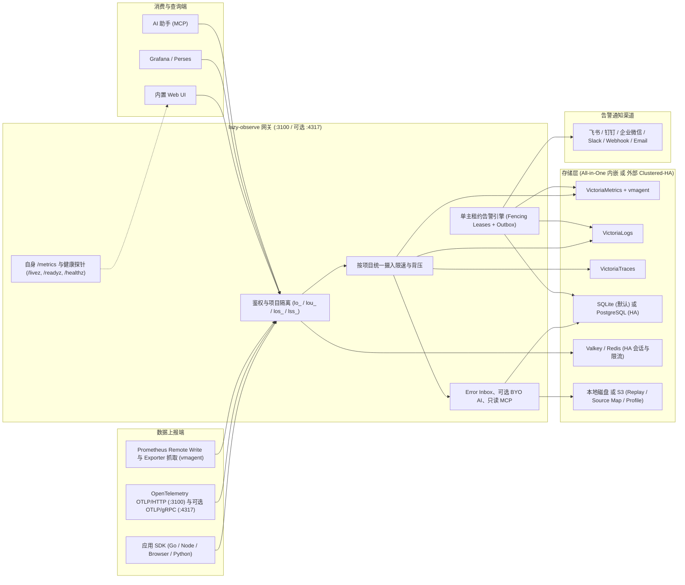

# lazy-observe

lazy-observe 是纯 Go 静态编译（`CGO_ENABLED=0`，支持 Linux `amd64` 与 `arm64`）的单二进制自托管全栈可观测性平台。它在一个项目隔离的平台内统一覆盖 Metrics、Logs、Traces、Error Tracking、Web Vitals、Session Replay、Continuous Profiling、Alerting 以及 GenAI 用量与成本统计。

默认形态下，单个二进制内嵌 VictoriaMetrics、VictoriaLogs、VictoriaTraces、`vmagent` 与 Web UI，无需外部依赖即可启动。单机容量不足或需要多副本高可用时，同一份二进制可切换到外置 Victoria 集群，并搭配 PostgreSQL、Valkey 或 Redis 以及 S3 兼容对象存储运行。

> **公开预览期（v0.x）。** 当前尚未发布带版本号的正式 Release（`v0.1.0`）。发布前阶段元数据仅维护一份可变的基线（`001_baseline.sql`，见 [ADR 0003](https://github.com/eimsound/lazy-observe/blob/main/.agents/docs/adr/0003-pre-release-single-database-baseline.md)）。跨不兼容 schema 变更升级可能需要重建元数据数据库，协议面与 SDK 也可能发生不兼容调整。升级前请先查阅[版本兼容矩阵](version-matrix.md)与 [CHANGELOG.md](https://github.com/eimsound/lazy-observe/blob/main/CHANGELOG.md)。

## 架构总览

- **最小对外端口。** 默认只有 `:3100` 接受外部连接，只有显式设置 `otlp_grpc.enabled: true` 后才会监听 `:4317`。All-in-One 模式下，网关将内嵌的四个 Victoria 程序解压到 `<data_dir>/bin`，仅绑定本机回环地址，并为每个子进程提供独立的指数退避重启循环。
- **网关侧硬性项目隔离。** 网关在所有读写请求上强制执行项目边界：对 VictoriaMetrics 重写 `project_id` 标签与查询过滤条件，对 VictoriaLogs 与 VictoriaTraces 覆盖上游 `AccountID` 和 `ProjectID` 请求头。
- **三种部署拓扑。**
  - **All-in-One（默认）。** 单二进制搭配纯 Go SQLite（WAL 模式）、本地磁盘 Blob 以及内嵌的 VictoriaMetrics、VictoriaLogs、VictoriaTraces 和 `vmagent`。
  - **Standalone。** 网关连接外部 VictoriaMetrics、VictoriaLogs 与 VictoriaTraces，支持读写端点拆分与可选托管 `vmagent`。
  - **Clustered-HA（`topology: ha`）。** 多无状态网关副本共享 PostgreSQL（元数据、告警租约 fencing、持久化通知 Outbox、`vmagent` 选主）、Valkey 或 Redis（共享会话与登录限流）、S3 兼容对象存储、共享平台加密密钥以及外部 Victoria 集群。可通过 `lazy-observe doctor --ha` 做只读预检，参考配置见三副本 [Helm Values 文件](https://github.com/eimsound/lazy-observe/blob/main/deploy/helm/lazy-observe/values-standalone-ha-cluster.yaml)。

## 核心能力

- **指标、日志与链路。** 支持 OTLP/HTTP（`:3100` 上的 `POST /v1/metrics`、`/v1/logs`、`/v1/traces`）、可选原生 OTLP/gRPC（`otlp_grpc.enabled: true`，默认 `:4317`，支持 gzip 与原生 TLS）、Prometheus remote-write 1.0（`POST /api/v1/write`）以及受管 `vmagent` 主动抓取。`/v1/metrics` 与 `/v1/logs` 仅接受 `application/x-protobuf`，`/v1/traces` 同时支持 Protobuf 与 JSON。指标查询提供与 CodeMirror 编辑器双向同步的可视化 PromQL 查询构建器，日志查询支持 VictoriaLogs LogsQL、字段统计与实时 Live Tail。
- **错误追踪与 Source Map。** 持久化元数据 Error Inbox 在满载时返回 `503` 与 `Retry-After` 背压，不会驱逐已接收事件。服务端按堆栈指纹归并 Issue、识别回归，并通过专用 CI Source Map 上传令牌（`los_...`）还原压缩后的前端堆栈。
- **浏览器 RUM 与隐私优先会话回放。** 采集 LCP、CLS、INP、TTFB、FCP 五项 Web Vitals，并附带低基数地理与设备维度（`country`、`device_type`、`browser_family`、`os_family`），绝不将原始 IP 或原始 User-Agent 写入指标标签。SDK 自动为 `fetch` 与 `XHR` 注入 W3C `traceparent`，DOM 会话回放默认遮蔽所有输入值，支持 `[data-lo-block]` 子树屏蔽，并在时间线上标注错误、HTTP 请求与 Web Vitals。
- **持续性能剖析。** 提供 Go（CPU、heap、goroutine）、Node.js（V8 CPU 与 sampled-heap）以及 Python（实验性，仅限 Linux 无 GIL 的 free-threaded CPython 3.15t 及以上版本进程内 CPU 采样，详见 [Python SDK 文档](sdk/python.md)）的 pprof 火焰图。
- **单主租约告警引擎与内置 IM 渠道。** 网关进程内置 PromQL/MetricsQL 规则、LogsQL 阈值规则以及新 Issue 与回归等平台事件评估器，无需额外部署 `vmalert` 或 Alertmanager。HA 模式使用 Rendezvous 一致性哈希、PostgreSQL fencing 租约（[ADR 0001](https://github.com/eimsound/lazy-observe/blob/main/.agents/docs/adr/0001-nightingale-style-alert-engine.md)、[ADR 0011](https://github.com/eimsound/lazy-observe/blob/main/.agents/docs/adr/0011-sqlite-alert-lease-millisecond-clock.md)）和事务级持久化 Outbox。支持分组、去重、风暴合并、静默、告警抑制规则管理页面与按渠道限流，内置飞书（Lark）、钉钉、企业微信、Slack、Webhook（带 `Idempotency-Key`）和 SMTP/Email 渠道。
- **GenAI 用量与成本、可选 BYO AI 与只读 MCP。** 基于 VictoriaTraces 中的 `gen_ai.*` Span 与内置定价表，默认常开统计 LLM Token 用量与估算费用，无需外部 LLM API Key。管理员可在 **Settings** 下的 **AI** 页面按需配置 BYO LLM（OpenAI、Anthropic、DeepSeek 或 Ollama，密钥经 256-bit 平台密钥加密存储且不回传浏览器），启用自然语言 MetricsQL/LogsQL 辅助与新 Issue 异步跨信号分析。外部 AI 客户端可通过只读 MCP 端点（`/mcp` 与 `lazy-observe mcp`）配合 `lou_...` 用户 API Token 查询项目数据。
- **生产安全护栏与自监控。** 严格区分四类隔离凭据（`lo_` 仅摄取、`lou_` 配合 `X-LO-Project` 用于用户读与 API、`los_` 仅用于 CI 上传 Source Map、`lss_` 用于 HTTP-only 浏览器会话 Cookie），提供按项目统一摄入限速（`ingest_rate_limit`，HTTP `429` 加 `Retry-After`、gRPC `ResourceExhausted` 加 `RetryInfo`）、可选 Prometheus `GET /metrics` 端点（`metrics_endpoint`，默认 fail-closed 鉴权）以及内置自监控。

## 文档导航

| 文档 | 内容范围 |
| --- | --- |
| [五分钟快速上手](quickstart.md) | 源码与 Docker Compose 双路径启动、首次登录改密、创建令牌以及 `curl` 与 Go Fiber v3 全信号验证 |
| [部署指南](deployment.md) | All-in-One、Standalone、PostgreSQL、Redis、S3、Helm HA、配置参考以及查询 API 与 MCP 接入 |
| [运维手册](operations.md) | 冷热备份、恢复、`doctor --ha` 预检、升级与回滚、密钥轮换以及应急密码重置 |
| [Grafana 与 Perses 对接指南](grafana-perses.md) | Prometheus 指标直连、Nginx 与 Caddy 日志/链路重写代理以及 Provisioning 清单 |
| 客户端 SDK：[Go](sdk/go.md)、[Node.js](sdk/node.md)、[Browser 与 React](sdk/browser.md)、[Python](sdk/python.md) | 显式接入指南，不做全局 Monkey-Patch |
| [平台对比](comparison.md) | 与 SigNoz、OpenObserve、Sentry、Traceway 的架构取舍对比，以及何时不要选 lazy-observe |
| [版本兼容矩阵](version-matrix.md) | 服务端与 SDK 协议契约、四类隔离凭据边界、摄入限速、`/metrics` 与兼容规则 |
| [安全策略](https://github.com/eimsound/lazy-observe/blob/main/SECURITY.md) | 预览期支持范围与通过 GitHub Security Advisories 私下提交漏洞的流程 |
| [贡献者指南](https://github.com/eimsound/lazy-observe/blob/main/CONTRIBUTING.md) | 本地开发环境、`mise` 任务、许可证门禁与测试分层 |
